# Proposed database schema

## Phase 3 implementation overlay (verified 2026-11-19)

Additive migration `004_phase_three_residue_recovery.sql` extends the Phase 1/2 schema; it does not create a second inventory journal or editable stockpile balance. It adds source-output and accepted-receipt references to movement lines; consignment recipient, dispatch and recorded-time fields; append-only status and receipt evidence; custody items and counterparty decisions; recovery input/output wrappers, source receipt mappings, output-to-input genealogy, process-stage classifications and variance records; and residue-sale decision history. Migration `005_phase_three_integrity_corrections.sql` adds linked receipt corrections, effective intake/source guards, and a mismatch-resolution marker for residue-sale revisions. Existing `residue_stockpile`, `recovery_inventory_location`, `inventory_movement`, `consignment`, `residue_sale` and material event tables remain the authoritative domain records.

PostgreSQL FKs and checks bind measurements, batches, consignment items, receipts and recovery events. Deferred triggers validate atomic stockpile/transit and transit/facility movement pairs, accepted receipt postings, recovery input consumption, complete output genealogy, custody offer/decision structure, and phase-specific status transitions. Current receipt claims across accepted, disputed and rejected outcomes cannot exceed accepted dispatch net of reversals; correction successors replace the current effective observation, and accepted receipt corrections require full paired reversals. Dora intake requires an exact current measured/verified output observation, and recovery genealogy cannot use superseded receipts. Mismatched sale decisions can be resolved only through a linked proposal and fresh agreement from both counterparties; accepted quantities are bounded by eligible stockpile inventory. Append-only triggers protect evidence rows. `inventory_balance_guard` serializes batch/location balance changes in stable order; consignment-item locks serialize receipt claims. Migration 004 rollback refuses to discard Phase 3 evidence, and migration 005 rollback refuses to remove correction-specific protections when receipt or mismatch-revision records exist. The full suite applies from an empty schema and verifies rollback/reapplication of migrations 003, 004 and 005.

## Status and design decisions

This document defines the relational design baseline. The Phase 1 implementation uses PostgreSQL with Sequelize for application access and reviewed SQL migrations for schema features, triggers and deferred integrity rules that need database-level enforcement. This supersedes the earlier conditional Prisma proposal recorded in D-14; see D-26. Do not weaken integrity for ORM convenience.

**Proposed measurement decision:** `material_measurement` is the only source of observed/declarative material quantities. `material_batch` stores identity and genealogy, never a mutable declared/current quantity. Transaction quantities and allocation quantities are distinct business facts, not physical measurement observations.

**Proposed inventory decision:** one append-only `inventory_movement` journal with `inventory_movement_line` postings is authoritative for physical inventory by batch and location. `residue_stockpile` describes a stockpile location; there is no separately writable `stockpile_movement` table. Stockpile history is a filtered view of the same journal.

**Proposed allocation decision:** an output has one allocation chain containing complete, immutable allocation-set revisions. Each set has one basis (`QUANTITY` or `SHARE`) shared by all its rows. A chain's single `active_approved_set_id` pointer identifies its current approved revision; earlier revisions and review events remain available.

**Proposed measurement ownership decision:** replace `context_kind/context_id` with nullable typed owner foreign keys on `measurement_set`, a CHECK requiring exactly one owner, and composite foreign keys that require the owner's batch to equal the set's batch. This uses a wider table but gives PostgreSQL direct referential integrity without a polymorphic pointer or an exactly-one-subtype trigger.

### Data classification

- **Operational:** sites, holes, material batches, material lineage, location movements, custody, measurements and QR references.
- **Financial / commercial:** trade quantities, prices, payments, counterparties and assay terms.
- **Sensitive personal:** names, contact details, identity documents, precise coordinates, account identifiers, credentials and private notes.
- **Ledger eligible:** opaque event/stream references, versioned event type, salted commitment, stream sequence/previous hash and network receipt. Never put personal data, exact coordinates, trade quantities, prices, payment details, raw assay results or documents on a public ledger. Permissioned data still requires minimization and membership controls.

## Entity relationship diagram

```mermaid
erDiagram
  PARTY ||--o| PERSON_PROFILE : describes
  PARTY ||--o| ORGANISATION_PROFILE : describes
  PARTY ||--o| USER_ACCOUNT : login_for
  PARTY ||--o{ PARTY_PARTICIPATION : participates_as
  USER_ACCOUNT ||--o{ ROLE_ASSIGNMENT : receives
  PARTY ||--o{ ORGANISATION_MEMBERSHIP : member
  PARTY ||--o{ ORGANISATION_MEMBERSHIP : organisation
  MINING_SITE ||--o{ MINING_HOLE : contains
  MINING_SITE ||--o{ SITE_PARTY_ROLE : has
  PARTY ||--o{ SITE_PARTY_ROLE : participates_at
  MINING_HOLE ||--o{ HOLE_PARTY_ROLE : has
  PARTY ||--o{ HOLE_PARTY_ROLE : assigned
  PROCESSING_FACILITY ||--o{ FACILITY_PARTY_ROLE : has
  RECOVERY_FACILITY ||--o{ FACILITY_PARTY_ROLE : has
  PARTY ||--o{ FACILITY_PARTY_ROLE : operates
  PARTY ||--o{ INVENTORY_LOCATION : custodian
  MINING_HOLE ||--o{ PRODUCTION_EVENT : produces
  MATERIAL_EVENT ||--o| PRODUCTION_EVENT : subtype
  PRODUCTION_EVENT ||--o{ PRODUCTION_EVENT_OUTPUT : produces
  MATERIAL_EVENT ||--o{ MATERIAL_EVENT_INPUT : consumes
  MATERIAL_BATCH ||--o{ MATERIAL_EVENT_INPUT : input
  MATERIAL_EVENT ||--o{ MATERIAL_EVENT_OUTPUT : creates
  MATERIAL_BATCH ||--o| MATERIAL_EVENT_OUTPUT : output
  MATERIAL_EVENT_OUTPUT ||--o| PRODUCTION_EVENT_OUTPUT : production_output
  PRODUCTION_EVENT_OUTPUT ||--o| PRODUCTION_ALLOCATION_CHAIN : allocation_chain
  PRODUCTION_ALLOCATION_CHAIN ||--o{ PRODUCTION_ALLOCATION_SET : revisions
  PRODUCTION_ALLOCATION_CHAIN o|--o| PRODUCTION_ALLOCATION_SET : current_approved_revision
  PRODUCTION_ALLOCATION_SET ||--|{ PRODUCTION_ALLOCATION_ROW : contains
  PRODUCTION_ALLOCATION_SET ||--o{ ALLOCATION_SET_REVIEW_EVENT : reviewed_by
  MATERIAL_MEASUREMENT o|--o{ ALLOCATION_SET_REVIEW_EVENT : basis_authorized_by
  PRODUCTION_ALLOCATION_SET ||--o{ PRODUCTION_ALLOCATION_SET : supersedes
  PARTY ||--o{ PRODUCTION_ALLOCATION_ROW : beneficiary
  MEASUREMENT_SET o|--o{ PRODUCTION_ALLOCATION_SET : quantity_basis
  MATERIAL_BATCH ||--o{ MEASUREMENT_SET : measured_in
  MEASUREMENT_SET ||--o{ MATERIAL_MEASUREMENT : observations
  MATERIAL_MEASUREMENT ||--o{ MEASUREMENT_REVIEW_EVENT : reviewed_by
  MATERIAL_EVENT_INPUT ||--o| MEASUREMENT_SET : input_quantities
  MATERIAL_EVENT_OUTPUT ||--o| MEASUREMENT_SET : output_quantities
  MATERIAL_EVENT ||--o| PROCESSING_EVENT : subtype
  PROCESSING_FACILITY ||--o{ PROCESSING_EVENT : processes
  MATERIAL_EVENT ||--o| RECOVERY_EVENT : subtype
  RECOVERY_FACILITY ||--o{ RECOVERY_EVENT : recovers
  INVENTORY_LOCATION ||--o| RESIDUE_STOCKPILE : stockpile_details
  PROCESSING_FACILITY ||--o{ RESIDUE_STOCKPILE : operates_at
  INVENTORY_LOCATION ||--o| RECOVERY_INVENTORY_LOCATION : facility_details
  RECOVERY_FACILITY ||--o{ RECOVERY_INVENTORY_LOCATION : stores_at
  INVENTORY_LOCATION ||--o| MERCHANT_INVENTORY_LOCATION : merchant_details
  PARTY ||--o{ MERCHANT_INVENTORY_LOCATION : holds_inventory
  INVENTORY_LOCATION ||--o{ INVENTORY_MOVEMENT_LINE : posts
  INVENTORY_LOCATION ||--o{ INVENTORY_BALANCE_GUARD : serializes
  MATERIAL_BATCH ||--o{ INVENTORY_BALANCE_GUARD : serializes
  INVENTORY_LOCATION ||--o{ INVENTORY_COUNT : counted_at
  MATERIAL_BATCH ||--o{ INVENTORY_COUNT : counted_batch
  INVENTORY_MOVEMENT ||--|{ INVENTORY_MOVEMENT_LINE : contains
  MATERIAL_BATCH ||--o{ INVENTORY_MOVEMENT_LINE : balance_for
  MATERIAL_MEASUREMENT ||--o{ INVENTORY_MOVEMENT_LINE : quantity_source
  CONSIGNMENT ||--|| INVENTORY_LOCATION : transit_location
  CONSIGNMENT ||--o{ CONSIGNMENT_ITEM : manifests
  MATERIAL_BATCH ||--o{ CONSIGNMENT_ITEM : source_batch
  CONSIGNMENT_ITEM ||--o{ INVENTORY_MOVEMENT_LINE : posted_for
  CONSIGNMENT_ITEM ||--o{ MEASUREMENT_SET : manifest_dispatch_receipt_measurements
  INVENTORY_COUNT ||--o| MEASUREMENT_SET : physical_count
  CONSIGNMENT ||--o{ TRANSPORT_RECORD : transported
  RESIDUE_SALE ||--o{ RESIDUE_SALE_LINE : sells
  RESIDUE_SALE ||--o| RESIDUE_SALE : superseded_by
  MATERIAL_BATCH ||--o{ RESIDUE_SALE_LINE : source
  RESIDUE_SALE_LINE ||--o{ RESIDUE_SALE_SHIPMENT_ITEM : dispatched_as
  CONSIGNMENT_ITEM ||--o{ RESIDUE_SALE_SHIPMENT_ITEM : fulfills
  GOLD_TRADE ||--o{ GOLD_TRADE_LINE : includes
  GOLD_TRADE ||--o| GOLD_TRADE : superseded_by
  MATERIAL_BATCH ||--o{ GOLD_TRADE_LINE : traded
  GOLD_TRADE_LINE ||--o| MEASUREMENT_SET : seller_and_buyer_observations
  RESIDUE_SALE_LINE ||--o| MEASUREMENT_SET : seller_and_buyer_observations
  GOLD_TRADE_LINE ||--o{ COMMERCIAL_LINE_DECISION_EVENT : decisions
  RESIDUE_SALE_LINE ||--o{ COMMERCIAL_LINE_DECISION_EVENT : decisions
  GOLD_TRADE ||--o{ PAYMENT : settled_by
  RESIDUE_SALE ||--o{ PAYMENT : settled_by
  PAYMENT ||--o{ PAYMENT_EVENT : history
  MATERIAL_BATCH ||--o{ ASSAY_RECORD : sampled
  MATERIAL_EVENT ||--o{ ENTITLEMENT_EVENT : changes
  PARTY ||--o{ ENTITLEMENT_EVENT : entitled_party
  MATERIAL_BATCH ||--o{ CUSTODY_TRANSFER : transferred
  INVENTORY_MOVEMENT ||--o| CUSTODY_TRANSFER : physical_movement
  PARTY ||--o{ CUSTODY_TRANSFER : from_party
  PARTY ||--o{ CUSTODY_TRANSFER : to_party
  MATERIAL_EVENT ||--o{ CAPTURE_PROVENANCE : capture_context
  PARTY o|--o{ CAPTURE_PROVENANCE : participant
  USER_ACCOUNT ||--o{ CAPTURE_PROVENANCE : recorder
  CAPTURE_PROVENANCE ||--o{ CAPTURE_ACKNOWLEDGEMENT_EVENT : acknowledgement_history
  PARTY o|--o{ CAPTURE_ACKNOWLEDGEMENT_EVENT : acknowledges
  USER_ACCOUNT ||--o{ CAPTURE_ACKNOWLEDGEMENT_EVENT : records
  AUDIT_EVENT ||--o{ AUDIT_STREAM_ENTRY : ordered_in
  AUDIT_STREAM_HEAD ||--o{ AUDIT_STREAM_ENTRY : sequence
  AUDIT_EVENT ||--o{ LEDGER_SUBMISSION : anchored_as
  MATERIAL_BATCH ||--o{ QR_RECORD : labeled
```

The ERD shows principal cardinalities; typed relationship and measurement tables below define key details. `MATERIAL_EVENT_OUTPUT` is the general output. Its optional `PRODUCTION_EVENT_OUTPUT` subtype makes a production output an explicit allocation source. One output has at most one allocation chain; the chain contains complete revisions, and each revision contains one or more beneficiary rows. The chain pointer allows at most one current approved revision. The same beneficiary can appear in sets for many outputs.

## Proposed tables, keys and relationships

Use UUID primary keys for records created offline. Human-readable codes are unique within an agreed namespace, not primary keys. All foreign keys should be database constraints. Times are UTC instants plus original local-time/offset metadata where needed.

### Identity and participant tables

- `party(id PK, party_kind PERSON|ORGANISATION, created_at, status)` stores each person/organisation once. Cooperatives remain optional.
- `person_profile(party_id PK/FK party, display_name, pii_fields...)`; `organisation_profile(party_id PK/FK party, display_name, organisation_kind, sensitive fields...)`. Keep identity documents in protected evidence storage.
- `organisation_membership(id PK, person_party_id FK, organisation_party_id FK, membership_type, valid_from, valid_to, status)` records optional effective-dated affiliations.
- `party_participation(id PK, party_id FK, participant_kind, valid_from, valid_to, status)` records business capacities such as miner, landowner, service provider, family/agreed beneficiary, local merchant, larger merchant or carrier. It is not a login role. `site_party_role` and `hole_party_role` separately record effective-dated site/hole relationships and the asserting user; optional `source_reference` and `evidence_ref` preserve beneficiary support where applicable.
- `user_account(id PK, person_party_id FK party UNIQUE nullable, login_subject UNIQUE, status, created_at)`; credentials belong in a protected identity service.
- `role_assignment(id PK, user_id FK, role_code, scope_kind, scope_id, granted_by_user_id FK, valid_from, valid_to, status)` grants one user multiple scoped application roles. Validate polymorphic scopes in the backend and with database constraints/triggers where practical.
- `mining_site`, `mining_hole`, `site_party_role`, `hole_party_role`, `processing_facility`, `recovery_facility`, and `facility_party_role` record sites, multiple holes, independent operators and multiple Doras. Site/permit/landowner relationships are recorded assertions, not legal verification. `facility_party_role` has exactly one of processing or recovery facility FK populated.

### Material events and measurements

- `material_batch(id PK, batch_code UNIQUE, material_kind, created_at, current_status)` contains identity only; provenance is linked through `material_event_output/input`. It has no declared, measured or current quantity columns. Material kinds remain within the gold chain (gold-bearing feed, residue, gold/dore, recovered gold and approved process outputs); this does not add support for other minerals.
- `material_event(id PK, event_code UNIQUE, event_kind, occurred_at_claimed, recorded_at, responsible_party_id FK, current_status DRAFT|SUBMITTED|ACCEPTED|REJECTED|VOIDED, schema_version, notes_ref nullable, supersedes_event_id FK nullable)` is a production, processing, recovery, movement, aggregation or correction event. Status is a projection; every state change is an append-only audit event.
- `measurement_set(id PK, batch_id FK, material_event_input_id FK nullable, material_event_output_id FK nullable, gold_trade_line_id FK nullable, residue_sale_line_id FK nullable, consignment_item_id FK nullable, consignment_stage MANIFEST|DISPATCH|RECEIPT nullable, inventory_count_id FK nullable, created_at)` groups observations for one batch and exactly one typed owner. A CHECK requires exactly one of the six owner IDs to be non-null; `consignment_stage` must be non-null only with `consignment_item_id`. Each owner column has a foreign key and uniqueness rule (consignment item plus stage is unique). Composite foreign keys `(owner_id,batch_id)` target matching `UNIQUE(id,batch_id)` keys on the context row, so a measurement set cannot name a batch different from its event input/output, trade line, consignment item or physical count. No `context_kind/context_id` polymorphic pointer is used. Context rows do not store a second measurement-set pointer.
- Context ownership is immutable after insert. A database trigger rejects updates to owner or batch columns, and the application role has no direct permission to delete accepted measurement history. Measurement sets are not shared between contexts. This typed-FK design is wider than a polymorphic pair and requires adding an owner FK for each newly supported context, but prevents orphan contexts and wrong-batch links with ordinary relational constraints. It avoids a deferred exactly-one-subtype trigger; CHECK/FK/UNIQUE constraints establish one valid owner.
- `material_measurement(id PK, measurement_set_id FK, measurement_kind DECLARED|MEASURED|VERIFIED, quantity_g NUMERIC(20,6), source_value NUMERIC(28,12), source_unit_code, conversion_version, source_role SELLER|BUYER|RECORDER|WITNESS|WEIGHER|OTHER, source_party_id FK nullable, entered_by_user_id FK nullable, method_code nullable, instrument_ref nullable, occurred_at_claimed, entered_at, evidence_ref nullable, supersedes_measurement_id FK nullable, UNIQUE(id,measurement_set_id))` is the authoritative observation ledger. `DECLARED` is an amount stated by the named source; `MEASURED` is an amount observed using the recorded method/instrument where available; `VERIFIED` means an independent procedure defined and authorized by the pilot was applied. These labels describe provenance and process, not truth by themselves. For production and processing contexts, migration 003 validates source-party attribution against effective event participants or facility relationships; only a `RECORDER` observation entered by that same party may use the recorder as its default source. A database trigger and table privileges prevent updating or deleting an observation or changing its `measurement_set_id`; each correction is a new row that supersedes the earlier one. Conflicting values remain visible.
- `measurement_review_event(id PK, material_measurement_id FK, review_status DISPUTED|ACCEPTED_FOR_CONTEXT|REJECTED|WITHDRAWN, actor_user_id FK, reason nullable, occurred_at, recorded_at)` is append-only. Separate observations are not automatically conflicts; a review event records an explicit challenge or context-specific acceptance.
- **Unit/precision proposal:** canonical mass is grams (`g`) stored to six decimal places in `NUMERIC(20,6)`; retain the raw entered quantity in `NUMERIC(28,12)` with its source unit and a versioned conversion to canonical grams. Six canonical decimals and twelve source decimals are storage limits, not claims about scale accuracy. The pilot must approve accepted source units, rounding rules, instrument resolution and verification methods. Never pad digits and call them measured precision.
- `material_event_input(id PK, event_id FK, batch_id FK, input_sequence, UNIQUE(id,batch_id))` and `material_event_output(id PK, event_id FK, batch_id FK UNIQUE, output_sequence, output_kind, UNIQUE(id,batch_id))` define lineage. They do not copy a quantity; a typed measurement set owned by the input/output holds its quantity observations.
- `production_event(event_id PK/FK material_event, hole_id FK, shift_or_period_ref nullable)`; `production_event_output(material_event_output_id PK/FK, production_event_id FK)` uses a composite FK to ensure the referenced `material_event_output` belongs to that same production event, restricting allocations to a production output from that event.
- `processing_event(event_id PK/FK, processing_facility_id FK, operator_party_id FK, service_terms_ref nullable)` and `recovery_event(event_id PK/FK, recovery_facility_id FK, operator_party_id FK, method_ref nullable)` specialize material events.
- `assay_record(id PK, batch_id FK, trade_line_id FK nullable, assayer_party_id FK nullable, sample_ref, method_ref, result_fields, unit, observed_at, evidence_ref, correction_of_id FK nullable)` stores assay facts separately from mass observations.

### Production allocations, entitlement and custody

- `production_allocation_chain(id PK, production_event_output_id FK UNIQUE, active_approved_set_id FK nullable, created_at)` establishes one revision chain for one production output. A composite deferred FK `(id,active_approved_set_id)` references `(allocation_chain_id,id)` on `production_allocation_set`, so the active pointer cannot point into another chain. A deferred constraint trigger requires its target to have a current `APPROVED` review state. One pointer per chain means at most one current approved revision.
- `production_allocation_set(id PK, allocation_chain_id FK, revision_no, revision_kind ORIGINAL|CORRECTION, basis_kind QUANTITY|SHARE, basis_measurement_set_id FK nullable, basis_measurement_id FK nullable, supersedes_set_id FK nullable, correction_reason nullable, proposed_by_user_id FK, created_at, UNIQUE(allocation_chain_id,revision_no), UNIQUE(allocation_chain_id,id), UNIQUE(id,basis_kind), UNIQUE(allocation_chain_id,supersedes_set_id), FK(allocation_chain_id,supersedes_set_id) -> production_allocation_set(allocation_chain_id,id))` is a complete immutable revision for its chain/output. For `QUANTITY`, the proposer explicitly names one `basis_measurement_id` from that output's typed measurement set; no query orders observations by timestamp to choose the basis. A CHECK requires the original to have revision 1 and no predecessor; a correction has a predecessor and nonempty reason. A deferred trigger verifies that a correction names the immediately preceding revision number in the same chain. A correction can be proposed after a disputed/rejected set but cannot overwrite it. A composite FK pairs `basis_measurement_id` with `basis_measurement_set_id`; a deferred constraint trigger requires that set to be the typed output measurement set for this chain's output. `SHARE` sets have neither basis measurement field; `QUANTITY` sets require both.
- `production_allocation_row(id PK, allocation_set_id FK, beneficiary_party_id FK, allocation_basis QUANTITY|SHARE, allocated_quantity_g NUMERIC(20,6) nullable, allocated_share NUMERIC(12,9) nullable, created_at, UNIQUE(allocation_set_id,beneficiary_party_id), FK(allocation_set_id,allocation_basis) -> production_allocation_set(id,basis_kind))` records one beneficiary's allocation within a complete set. The composite FK requires every row to use the set's basis, so quantity and share rows cannot be mixed in one revision. A CHECK requires exactly the matching value and nonnegative quantity or a share from 0 through 1; each row explicitly names its beneficiary and basis. A database trigger requires an active, effective-dated `BENEFICIARY` relationship to the output's site or hole at the production event time.
- Migration 003 can be reversed before recording its new participant kinds by running `server/src/database/rollback/003_phase_two_integrity.sql`. The script refuses rollback while service-provider or family/agreed-beneficiary kinds are present; convert or retain those records before attempting a rollback.
- `allocation_set_review_event(id PK, production_allocation_set_id FK, review_sequence, review_status PENDING|PROVISIONAL|DISPUTED|APPROVED|REJECTED|WITHDRAWN, authorized_basis_measurement_id FK nullable, actor_user_id FK, reason nullable, evidence_ref nullable, occurred_at, recorded_at, UNIQUE(production_allocation_set_id,review_sequence))` is append-only and applies to the complete set and all rows in it. A deferred constraint requires the first event to be `PENDING`; `PROVISIONAL` records an explicitly provisional review and never advances the current-approved pointer. An `APPROVED` event for a quantity set must repeat its exact `basis_measurement_id` in `authorized_basis_measurement_id`; a deferred trigger requires equality with the immutable set selection. The reviewer must hold the pilot-authorized allocation-review role for that output. This approval event is the explicit authorization of both the set and its measurement basis; the proposer alone does not authorize it by default. For a share set, the authorized basis field is null. Current status is the highest review sequence. To approve, the server locks its chain, validates basis-specific totals, checks the expected preceding revision and atomically appends approval and advances `active_approved_set_id`. A stale concurrent revision conflicts. If the active set becomes disputed, rejected or withdrawn, clear the pointer in that transaction; do not automatically reactivate an older set. Previous sets and review events remain accessible; the active pointer is a projection, not historical evidence.
- If measurements conflict, keep each observation and its review history visible. The authorized reviewer explicitly selects one eligible observation and records the basis authorization and reason/evidence; no latest-measurement-wins rule applies. Whether a quantity set may use `DECLARED`, must use `MEASURED`, or requires `VERIFIED` evidence is a pilot policy decision. If a selected measurement is later corrected, disputed or rejected, do not retarget the approved set. Append a review that disputes/withdraws the affected allocation set and clears its active pointer; create a correction allocation set naming the chosen observation and require fresh approval. The old observation and allocation revision remain auditable.
- Every set has at least one row. Quantity-based rows use one shared output measurement and their approved total cannot exceed that measurement; share-based rows sum to at most 1.0. Do not require full allocation of the output unless participants approve that rule. Totals are checked by a deferred constraint trigger and command transaction while the chain row is locked. Approval records the participant-agreed allocation only; it is not legal title, entitlement or physical custody.
- `entitlement_event(id PK, event_id FK, batch_id FK, party_id FK, entitlement_kind, quantity/share, basis, effective_at, supersedes_id FK nullable)` records a separate entitlement assertion/decision.
- `custody_transfer(id PK, batch_id FK nullable, consignment_id FK nullable, from_party_id FK, to_party_id FK, offered_at, accepted_at nullable, status, offered_by_user_id FK, accepted_by_user_id FK nullable, linked_inventory_movement_id FK nullable, correction_of_id FK nullable)` records offer and response, but no duplicate quantity. Its physical amount is derived from linked inventory movement postings. Exactly one of batch/consignment is targeted. Entitlement, custody, measurement and allocation remain separate facts.

### One authoritative inventory journal

- `inventory_location(id PK, location_code UNIQUE, location_kind STOCKPILE|CONSIGNMENT_TRANSIT|RECOVERY_FACILITY|MERCHANT|OTHER, custodian_party_id FK, status)` identifies the physical inventory account and responsible custodian. Where custody changes but material remains at one physical site, use distinct location accounts tied to that physical place and post a balanced transfer between them. This records accountability without asserting entitlement/ownership.
- `residue_stockpile(inventory_location_id PK/FK inventory_location, stockpile_code UNIQUE, processing_facility_id FK, operator_party_id FK, location_ref nullable)` adds Dora stockpile details only. `recovery_inventory_location(inventory_location_id PK/FK inventory_location, recovery_facility_id FK, location_ref nullable)` and `merchant_inventory_location(inventory_location_id PK/FK inventory_location, merchant_party_id FK)` type facility/merchant locations. A typed-location constraint requires the correct subtype for `location_kind`. None of these subtypes has its own movement table or balance.
- `consignment(id PK, consignment_code UNIQUE, sender_party_id FK, recipient_party_id FK, transit_location_id FK inventory_location UNIQUE, status, dispatched_at nullable, received_at nullable)`. `consignment_item(id PK, consignment_id FK, batch_id FK, line_no, UNIQUE(consignment_id,line_no), UNIQUE(id,batch_id))` is a manifest/source reference, not an inventory posting. Its measurement sets are typed-owned by `(consignment_item_id,consignment_stage)` in the measurement-set table.
- `transport_record(id PK, consignment_id FK, carrier_party_id FK nullable, vehicle_ref nullable, departure/arrival times, evidence_ref nullable)` captures approved transport details.
- `inventory_count(id PK, location_id FK, batch_id FK, counted_at_claimed, recorded_at, actor_user_id FK, evidence_ref nullable, UNIQUE(id,batch_id))` records a physical-count context; its measurement set is typed-owned by `inventory_count_id` and the same batch.
- `inventory_movement(id PK, event_id FK UNIQUE nullable, movement_kind TRANSFER|TRANSFORMATION|ADJUSTMENT|OPENING_BALANCE|REVERSAL, current_status DRAFT|ACCEPTED|REJECTED|VOIDED, reason, actor_user_id FK, occurred_at_claimed, recorded_at, reverses_movement_id FK nullable)` is the sole journal header. `current_status` is a projection whose changes are audit events. Accepted movements and lines are immutable; reversal/correction is a new linked movement. Only an unaccepted draft may become `VOIDED`.
- `inventory_movement_line(id PK, inventory_movement_id FK, batch_id FK, location_id FK, direction IN|OUT, posted_quantity_g NUMERIC(20,6) CHECK > 0, basis_measurement_set_id FK nullable, basis_measurement_id FK nullable, consignment_item_id FK nullable, material_event_input_id FK nullable, material_event_output_id FK nullable, gold_trade_line_id FK nullable, residue_sale_line_id FK nullable, reverses_line_id FK inventory_movement_line nullable, line_no, UNIQUE(inventory_movement_id,line_no))` is the authoritative balance posting. Composite FKs require `(basis_measurement_set_id,batch_id)` to match a measurement set and `(basis_measurement_id,basis_measurement_set_id)` to match a measurement in that set. Composite FKs likewise require manifest item and event input/output references to match the posted batch. A line's basis measurement and set are both null or both populated. A line can refer to at most one commercial line, or neither for non-trade movement. Reversal lines reference the exact original line they offset.
- `inventory_balance_guard(location_id FK,batch_id FK, lock_version, PRIMARY KEY(location_id,batch_id))` is a lock row only; it stores no quantity and is never the balance source. Before accepting a movement, the service inserts missing guards, locks all affected location/batch keys in sorted order, derives balances from accepted journal lines, and checks each proposed OUT leaves a nonnegative balance. Every writer, including correction and adjustment commands, must follow this protocol.
- **Valid movement reference combinations** are checked by local CHECK constraints plus a deferred constraint trigger that reads the header and referenced rows:
  - `TRANSFER`: every batch has exactly one OUT and one IN at distinct locations, with equal positive quantities and the same required measurement set/observation; the selected observation quantity equals that pair's posting quantity. Consignment mode has `event_id` null and references the same `consignment_item_id` on both legs with matching batch; event input/output references are null. Event mode requires header `event_id`, an OUT reference to an input of that event and an IN reference to an output of that event, each matching the posted batch; consignment references are null. These modes cannot be mixed. An uncontextualized internal transfer has no event or consignment context references and must carry a reason. At most one commercial reference is allowed, only on the OUT line; the paired IN line forbids both commercial FKs. `reverses_line_id` and header `reverses_movement_id` are forbidden. Partial transfers use separate headers and distinct measurement observations.
  - `TRANSFORMATION`: header `event_id` is required. Every OUT line requires only `material_event_input_id`; every IN line requires only `material_event_output_id`. A deferred trigger requires each referenced row to belong to that exact header event and match the line batch. A consignment item may identify a consumed source lot on an OUT line, but cannot substitute for the event input. The basis measurement must be owned by the exact event input/output context. Commercial-line and reversal references are forbidden.
  - `ADJUSTMENT`: header `event_id` and `reverses_movement_id` are null. Commercial, consignment, event input/output and reversal references are forbidden. It requires a count measurement whose owning `inventory_count` matches the line batch and location; direction and positive magnitude must equal the signed difference between that count and the derived balance. Zero variance creates no line.
  - `OPENING_BALANCE`: header `event_id` and `reverses_movement_id` are null. IN only; requires an initial count/measurement and evidence. Its measurement set must belong to an `inventory_count` for the same batch/location, and the measured quantity must equal the opening posting. Commercial, consignment, event input/output and reversal references are forbidden. Authorization is recorded with the movement header.
  - `REVERSAL`: header `event_id` is null; header `reverses_movement_id` and each line's `reverses_line_id` are required. The target must be an accepted line in that header's target movement; batch and location match, direction is opposite, and cumulative reversals cannot exceed the target quantity. Measurement, consignment, event input/output and commercial-line references are forbidden because the exact original-line link retains that provenance.
  A CHECK forbids both commercial FKs on one line and requires the measurement ID/set pair together. The deferred trigger rejects wrong-kind references, missing/extra context references, unmatched transfer legs, event input/output references from another event, duplicate transfer legs for the same batch/direction, and over-reversal. An actor-scoped unique idempotency key, claimed in the same transaction as the movement, prevents retrying the same command from posting it twice; line references themselves do not provide idempotency. Only accepted movement lines create balances. A context or commercial ID annotates its one line; it does not create another posting. In particular, commercial-line references occur only on physical OUT lines, while the paired IN is an inventory fact without a second commercial debit. Consignment manifests and `residue_sale_shipment_item` mappings never post inventory.
- A header CHECK enforces `event_id` and `reverses_movement_id` presence by `movement_kind` (`TRANSFORMATION` requires the former; `REVERSAL` requires the latter; other kinds forbid reversal targets, and only event-linked transfers may have `event_id`). The deferred trigger validates the matching event, target movement and line-level rules. Constraints and the trigger run at transaction commit after all movement lines exist; direct writes that bypass the domain transaction are revoked for ordinary roles.
- For `TRANSFER`, a deferred constraint trigger requires paired OUT and IN totals to match per batch at distinct locations, with matching measurement basis and valid consignment references where applicable. A selected material observation is required and its quantity must equal the posted transfer total. The complete movement posts in one database transaction. Processing `TRANSFORMATION` movements must reference matching material-event input/output rows and measurements owned by those exact input/output contexts; they record consumed inputs and created outputs but need not have equal total mass. Any difference has a reason/variance record. `ADJUSTMENT` must link a count measurement for the same batch/location and posts `ABS(counted quantity - derived balance)`; positive difference is IN and negative difference is OUT. A zero variance creates no movement. `OPENING_BALANCE` is separately authorized, evidenced and linked to an initial count/measurement. `REVERSAL` links an accepted movement; each reversal line points to the exact original line, uses the same batch/location and opposite direction, and cannot exceed the still-unreversed quantity. Reversals are subject to the same nonnegative-balance check.
- Acceptance of a movement, its complete line set, balance validation, related measurement/custody links and audit entries occur in one PostgreSQL transaction. A deferred constraint trigger rejects invalid movement shape, a transfer missing a leg or unequal per-batch legs, and a negative resulting balance; rollback leaves no partial movement. The trigger obtains affected balance-guard rows in sorted order and validates the journal-derived balance. The application prelocks these same rows for early conflict feedback. Revoke direct DML on accepted journal tables from ordinary clients; the trusted domain service uses the specified transaction path. Draft/rejected movements do not enter balances.
- **No double counting:** a transfer is one movement with balanced source and destination legs, not an ADD in a stockpile ledger plus a second ADD in a facility ledger. For example, Dora stockpile OUT + consignment transit IN; then consignment transit OUT + recovery facility IN. The manifest links sources but does not alter balances.
- `inventory_balance` is a derived view: for each batch and location, sum accepted IN postings minus accepted OUT postings using canonical grams. No `current_quantity` is authoritative. All accepted movement types, including reversal and adjustment, must preserve a nonnegative balance.
- Physical reconciliation compares a count measurement with the derived balance. Any difference becomes a reasoned, authorized `ADJUSTMENT` movement with linked evidence; never edit the projection. A count does not itself rewrite history.
- Retire `stockpile_movement` as a writable table. If a compatibility/read model is useful, expose a view filtered from `inventory_movement_line` for locations with `location_kind=STOCKPILE`.

### Residue sales, gold trades and payment history

- `residue_sale(id PK, sale_code UNIQUE, seller_party_id FK, buyer_party_id FK, agreed_at, currency_code, terms_ref nullable, supersedes_sale_id FK nullable, correction_reason nullable, UNIQUE(id,currency_code), UNIQUE(supersedes_sale_id), CHECK successor => nonempty correction_reason)`; `residue_sale_line(id PK, residue_sale_id FK, batch_id FK, revision_no, revision_kind ORIGINAL|CORRECTION, transaction_quantity_g NUMERIC(20,6), accepted_trade_quantity_g NUMERIC(20,6) nullable, unit_price, line_amount, supersedes_line_id FK nullable, correction_reason nullable, UNIQUE(id,batch_id))` records immutable Dora-to-recovery-facility sale-line revisions, separately from shipment/receipt, movement, custody and payment. A measurement set is typed-owned by the sale line. A successor sale has a nonempty correction reason; it does not rewrite the predecessor.
- `residue_sale_shipment_item(id PK, residue_sale_line_id FK, consignment_item_id FK, mapped_quantity_g NUMERIC(20,6), basis_measurement_id FK, UNIQUE(residue_sale_line_id,consignment_item_id,basis_measurement_id))` maps the accepted commercial quantity fulfilled by a dispatched lot. `mapped_quantity_g` is a commercial allocation, not a new weight observation; the basis measurement links to the manifest/dispatch quantity. A constraint/transaction check requires both sides to reference the same batch and mapped quantity not to exceed accepted sale quantity or the corresponding dispatched amount.
- `gold_trade(id PK, trade_code UNIQUE, trade_kind PURCHASE|RESALE, buyer_party_id FK, seller_party_id FK, agreed_at, currency_code, terms_ref nullable, supersedes_trade_id FK nullable, correction_reason nullable, UNIQUE(id,currency_code), UNIQUE(supersedes_trade_id), CHECK successor => nonempty correction_reason)` and `gold_trade_line(id PK, trade_id FK, batch_id FK, revision_no, revision_kind ORIGINAL|CORRECTION, transaction_quantity_g NUMERIC(20,6), accepted_trade_quantity_g NUMERIC(20,6) nullable, unit_price, line_amount, assay_record_id FK nullable, supersedes_line_id FK nullable, correction_reason nullable, UNIQUE(id,batch_id))` represent direct miner-to-local-merchant, merchant resale and recovery-facility-to-larger-merchant transactions. A measurement set is typed-owned by the trade line, not stored as a competing owner pointer. A successor trade has a nonempty correction reason; it does not rewrite the predecessor.
- `commercial_line_decision_event(id PK, gold_trade_line_id FK nullable, residue_sale_line_id FK nullable, decision ACCEPT|DISPUTE|REJECT|WITHDRAW, actor_user_id FK, actor_party_id FK, occurred_at, recorded_at, reason nullable, evidence_ref nullable)` is append-only and has exactly one line FK. Both counterpart parties must accept the same line revision before it is treated as accepted; a revised quantity requires a new line revision and fresh decisions. The accepted quantity is stored on that accepted revision, not inferred from a measurement.
- **Trade quantity meanings:** `transaction_quantity_g` is the quantity proposed for that line revision; `accepted_trade_quantity_g` is the amount counterparties have accepted for commercial settlement, nullable until acceptance. Neither is a weighing observation. Seller-declared and buyer-measured weights are separate `material_measurement` rows in the line's set. They remain visible even if the accepted trade quantity is negotiated to a different amount. A correction creates a new line revision linked to the prior one.
- **Line acceptance:** the line revision is immutable. It is accepted only when both seller and buyer have separate `ACCEPT` decision events for that same revision. A dispute/rejection remains in the decision history. A new quantity creates a new revision and requires new counterparty decisions; old proposals and observations remain visible.
- `payment(id PK, gold_trade_id FK nullable, residue_sale_id FK nullable, currency_code NOT NULL, payer_party_id FK, payee_party_id FK, created_at, CHECK exactly one parent, UNIQUE(id,currency_code))` belongs to exactly one gold trade or residue sale. Composite FKs `(gold_trade_id,currency_code)` and `(residue_sale_id,currency_code)` reference the parent's unique `(id,currency_code)`, enforcing the parent's currency. `payment_event(id PK, payment_id FK, currency_code, event_kind REPORTED|CONFIRMED|FAILED|REVERSAL|CORRECTION, direction CREDIT|DEBIT, amount NUMERIC, method_code, external_ref nullable, occurred_at_claimed, recorded_at, actor_user_id FK, related_event_id FK nullable, reason nullable, evidence_ref nullable)` is append-only and has composite FK `(payment_id,currency_code)` to `payment(id,currency_code)`. Thus an event cannot use another currency. No exchange is implied; the initial design supports one currency per parent transaction and no conversion. Currency code is not defaulted to KES.
- **Currency immutability:** a `BEFORE UPDATE OF currency_code` trigger on both `gold_trade` and `residue_sale` raises an error whenever `NEW.currency_code IS DISTINCT FROM OLD.currency_code`, including before any payment exists. The application role also has no column-level `UPDATE` grant for either currency field and cannot disable the trigger. A CHECK requires a nonempty correction reason on a successor transaction; a unique `supersedes_*_id` allows at most one direct successor. A mistaken currency is corrected by inserting a successor transaction with the appropriate `supersedes_*_id`, reason and replacement lines/payments; the predecessor and its payment/event history remain unchanged. Composite FKs from `payment` to parent `(id,currency_code)` and from `payment_event` to payment `(id,currency_code)` remain the consistency enforcement. These controls constrain application/database roles; a superuser or table owner able to alter schema or disable triggers remains outside this guarantee and must be separately controlled and audited.
- Currency conversion is excluded from the proposed MVP. If approved later, add an append-only `payment_conversion_event(id PK, payment_event_id FK, original_amount, original_currency_code, converted_amount, target_currency_code, exchange_rate, converted_at, rate_source, evidence_ref nullable)`. The original `payment_event` remains unchanged; the conversion record does not silently change the parent transaction's settlement currency. Its use in reconciliation requires a separate approved rule.
- Partial settlement uses multiple payment rows/events. A report is a claim, not confirmed settlement. Confirmed amounts count toward settlement; reversal/correction events compensate earlier events and reference them. Check over-reversal and duplicate external references transactionally. Reconcile net confirmed amounts against accepted line amounts per currency; do not net across currencies without a separately approved exchange-rate fact.
- **Trade-linked inventory deductions:** only actual physical movement creates journal lines. For both `gold_trade_line` and `residue_sale_line`, a commercial reference is permitted only on an accepted `TRANSFER` OUT line that references the currently accepted leaf revision and its measurement basis; a superseded line cannot receive new OUT postings. The paired IN has no commercial reference. A deferred constraint trigger validates both when a movement is accepted and when an accepted line revision/correction is accepted: it locks the relevant parent/line chain before inventory guards, finds the currently accepted revision, and requires cumulative accepted OUT quantity less valid linked reversals across that line's revision chain to be no greater than that revision's `accepted_trade_quantity_g`. A correction that lowers the accepted quantity is rejected until valid compensating reversals bring the net within the new cap. The same lock order is used by command handlers; concurrent acceptance or dispatch serializes on the commercial parent/chain, then inventory guard rows. Adjustments cannot carry commercial references and cannot be used to bypass this cap. Sale agreement, accepted quantity, physical movement, payment and custody remain independent facts.

### Assisted capture, audit, QR and ledger tables

- `capture_provenance(id PK, material_event_id FK, actual_participant_party_id FK nullable, participant_identity_state IDENTIFIED|UNRESOLVED|UNKNOWN, entered_by_user_id FK, source_kind DIRECT|ASSISTED_VERBAL|WITNESS|PAPER_TRANSCRIPTION|OTHER, occurred_at_claimed, entered_at, source_reference nullable, evidence_ref nullable, note nullable)` records who the event concerns, who entered it and where information came from. Unknown actual participant is explicit; the recorder is never substituted.
- `capture_acknowledgement_event(id PK, capture_provenance_id FK, status ACKNOWLEDGED|PENDING|DECLINED|DISPUTED|NOT_OBTAINED, acknowledged_by_party_id FK nullable, recorded_by_user_id FK, method nullable, occurred_at_claimed, recorded_at, reason nullable)` is append-only. Current acknowledgement status is derived from its latest event; no acknowledgement event means `NOT_OBTAINED`. A recorder entry never implies consent/approval.
- `audit_event(id PK, event_type, actor_user_id FK nullable, actor_party_id FK nullable, client_mutation_id UUID nullable, schema_version, occurred_at_claimed, recorded_at, canonical_payload_ref, payload_commitment, hash_algorithm)` stores one immutable event payload commitment; it does not hold a universal sequence.
- `audit_stream_head(stream_kind, stream_id, last_sequence, head_hash, updated_at, PRIMARY KEY(stream_kind,stream_id))` tracks the current tip for each aggregate stream.
- `audit_stream_entry(id PK, audit_event_id FK, stream_kind, stream_id, sequence, previous_hash, entry_hash, created_at, UNIQUE(stream_kind,stream_id,sequence), UNIQUE(audit_event_id,stream_kind,stream_id))` places an event into each affected aggregate's ordered chain.
- `idempotency_receipt(id PK, actor_scope, client_mutation_id UUID, request_hash, response_ref, accepted_at, UNIQUE(actor_scope,client_mutation_id))` returns the original result for the same key/payload and rejects key reuse with a different payload.
- `outbox_event(id PK, audit_event_id FK UNIQUE, commitment_payload, status, attempt_count, next_attempt_at, created_at)`; `ledger_submission(id PK, audit_event_id FK, network_id, transaction_id nullable, status, submitted_at nullable, committed_at nullable, receipt_ref nullable, UNIQUE(network_id,audit_event_id))` records async ledger handoff.
- `qr_record(id PK, public_token UNIQUE, material_batch_id FK, created_at, status, rotated_from_id FK nullable)` uses opaque high-entropy tokens. No names, weights, prices, precise coordinates or predictable IDs are encoded.
- `evidence_reference(id PK, storage_key, content_hash, media_type, classification, uploaded_by_party_id FK, captured_at nullable, retention_state)` points to protected object storage.

## Core integrity constraints

1. Measurement values, allocation quantities, accepted trade quantities and movement postings use nonnegative canonical grams; actual inventory line postings are strictly positive. Share values are fractions from 0 through 1. Monetary values always carry a transaction currency. Corrections append linked facts rather than overwriting numbers.
2. One `production_allocation_chain` references exactly one production output. Every set belongs to one chain and is a complete revision; each row names one beneficiary. Composite FKs require the row basis to equal the set basis. CHECK constraints require the quantity or share field to match that basis, never both. Thus a set cannot mix quantity and share rows.
3. Allocation set revisions have unique chain/revision numbers and a single-predecessor link. Review history is append-only with `PENDING`, `PROVISIONAL`, `DISPUTED`, `REJECTED`, `APPROVED` and `WITHDRAWN` states. `PENDING` means awaiting review; `PROVISIONAL` is explicitly non-final and does not become current approved. A deferred constraint trigger validates that every set has rows, begins with a pending review event, quantity totals use the output's exact typed measurement set and do not exceed its basis, and share totals do not exceed 1.0. It does not require full allocation. Approval serializes on the chain row and updates its single active-approved pointer in the same transaction; the pointer target must be an approved set in that chain. Revisions are never destructively edited.
4. A measurement set must have exactly one typed owner by CHECK; its context owner FK and composite `(owner_id,batch_id)` FK prevent an orphan or a batch mismatch. Owner and batch are immutable. Each `material_measurement` references a real set; database privileges/triggers prevent updating, deleting or reassigning the observation. The source role/kind distinguishes a participant declaration from a scale observation; neither label alone claims independent verification.
5. Inventory lines require positive quantity and valid composite FKs for batch, measurement, event input/output and consignment item. A deferred constraint trigger requires each accepted `TRANSFER` to have equal OUT and IN totals per batch, distinct valid locations and a measurement whose quantity equals the posting total. `TRANSFORMATION` lines must map consumed inputs and created outputs to their typed quantity observations but can differ in total mass; a reason records known variance. `ADJUSTMENT` uses count/evidence to post only the calculated variance; `OPENING_BALANCE` requires separate authorization/evidence. A `REVERSAL` line must offset an unreversed original line with the same batch/location and opposite direction, never exceeding its remaining quantity. Only these explicit types may have their defined non-transfer shapes.
6. No accepted movement can produce a negative batch/location balance. The transaction locks one `inventory_balance_guard` row for each affected `(location_id,batch_id)` in sorted order, calculates current accepted balance from the journal, validates all proposed postings, then commits header, all lines, projection status and audit entries atomically. Every writer follows the same guard protocol. A deferred shape trigger rejects incomplete transfers; rollback leaves no one-sided postings. Corrections are compensating movements, not edits. Reconciliation records the discrepancy and adjustment evidence; it does not label the cause as fraud or theft.
7. Gold trade and residue sale each have one immutable currency code. A payment's `(parent_id,currency_code)` composite FK must match its exactly-one parent transaction, and each payment event has a composite FK to its payment's same currency. This prevents transaction/payment/event currency disagreement. No currency conversion or KES default is assumed. Reversals/corrections reference prior events and cannot exceed un-reversed confirmed amount in that currency.
8. Trade seller and buyer differ. An accepted line revision requires an authorized `ACCEPT` decision from both counterparties. For both gold trades and residue sales, cumulative net unreversed commercial-line OUT postings across a correction chain cannot exceed its current accepted quantity; deferred triggers and parent/chain row locks enforce the cap when movements or accepted line revisions change. Adjustments cannot bypass it. Sale, accepted quantity, payment, inventory, custody and entitlement do not imply one another.
9. Receipt observations are append-only and form a single-successor chain. The effective quantity for an item is its current leaf claims across `ACCEPTED`, `DISPUTED` and `REJECTED`; this aggregate cannot exceed accepted dispatch net of reversals. The receipt insert trigger locks the consignment item before reading current claims, and service commands lock the same row. Accepted correction successors must reverse both original receipt transfer legs in full before posting any replacement movement.
10. Accepted Dora `INTAKE` movement lines must reference a `MEASURED` or `VERIFIED` observation in the measurement set for that exact `material_event_output` and batch; observation and posting quantities must match, and no successor may supersede the observation. Recovery source rows must reference a current accepted receipt leaf.
11. A residue-sale revision flagged as resolving mismatched decisions must supersede the current unresolved line after seller and buyer recorded different accepted quantities. The marker is immutable; each party must separately accept the successor before a line becomes accepted. Accepted residue-sale quantity cannot exceed available source stockpile balance net of other outstanding commitments.
12. Unique client mutation ID is scoped to actor. Same key/same payload returns the prior receipt; same key/different payload conflicts. Concurrent stale inventory, transfer or allocation approval returns a conflict rather than overwriting.
13. No deleting batches, measurements, allocation revisions, payment events or accepted movement history. Evidence/state corrections append linked facts with actor, time and reason.

## Transaction boundaries and concurrency

- **Domain command:** begin one PostgreSQL transaction by claiming the unique `(actor_scope, client_mutation_id)` with its request hash. A concurrent duplicate blocks on that unique key; after the first transaction commits it returns the stored response if hashes match, or a conflict if they differ. Only the winning request validates expected versions and writes domain rows, measurement links, inventory postings, audit payload, all affected stream entries/heads, final receipt and any outbox item. All local effects commit or none do.
- **Global database lock order:** after claiming idempotency, lock required domain revision/settlement rows (including trade/sale parent and commercial-line-chain rows needed for accepted-quantity caps), then inventory balance guards, then audit stream heads. Within each lock class sort keys lexicographically; insert missing guard/head rows with conflict-safe insert before locking. Every command observes this class order. The audit stream remains per aggregate; this lock order is only for deadlock prevention, not a global event sequence.
- **Audit stream locking:** sequence **per aggregate stream**, not one global sequence and not one database-wide order. After domain locks and inventory guards are held, enumerate and sort affected `(stream_kind, stream_id)` keys lexicographically. In that order, lock each head with `SELECT ... FOR UPDATE`. Allocate `last_sequence + 1`, set `previous_hash=head_hash` (the first entry uses 32 zero bytes), compute `entry_hash` over a domain separator and JCS object containing stream key, sequence, previous hash and event commitment, insert entries and update heads in the same transaction. Sorted locking avoids cross-aggregate lock-order deadlocks; unique constraints and retry handle first-row races. Exact encoding/formula is specified in [Blockchain design](BLOCKCHAIN_DESIGN.md).
- Different aggregate streams proceed concurrently. A cross-aggregate command writes a stream entry for every affected aggregate in the same transaction. There is no claimed global chronological ordering across streams; timestamps are not a total order. A verifier checks each stream and follows shared event IDs/foreign keys across streams.
- **Duplicate submission:** the unique idempotency receipt serializes concurrent retries. Same scoped key and request hash returns the stored result; a changed hash is rejected. Different keys racing on the same aggregate serialize on its stream/version locks; stale domain versions conflict and require review.
- **Allocation revision/approval:** lock the allocation chain row before assigning the next revision, checking predecessor/current pointer, calculating homogeneous quantity/share totals and approving. Append review events and move the single active-approved pointer in that transaction. A stale revision conflicts; a failed approval leaves the previous pointer and history unchanged.
- **Measurement ownership:** typed owner foreign keys, one-owner CHECK, context uniqueness and composite batch FKs are database constraints. Context ownership cannot be changed after insert. No polymorphic `context_kind/context_id` is relied on for referential integrity.
- **Inventory acceptance:** use PostgreSQL `READ COMMITTED`; after locking any relevant commercial parent/line chain, insert missing `inventory_balance_guard` rows with conflict-safe insert, lock every affected `(location_id,batch_id)` in stable sorted order, then in a subsequent statement derive balances from accepted journal lines and validate post-command balances and commercial caps. A deferred database constraint trigger repeats movement shape, reference-combination, line-cap and nonnegative-balance validation at commit; direct DML is restricted so all accepted writers use this protocol. Write movement header/lines, accepted status and audit entries in one transaction. Retry deadlocks/transient failures idempotently. Failed transactions leave no movement leg or accepted status.
- **Inventory corrections/reconciliation:** accepted journal facts are immutable. Corrections append linked reversal or adjustment movements with counter-postings; reversals cannot exceed unreversed lines or produce negative balances. If downstream movements make an exact reversal impossible, record a supported compensating adjustment and review instead of rewriting history. Physical recount creates a new count and reasoned adjustment. The derived balance may expose a discrepancy but does not infer culpability.
- **Payment:** composite currency FKs enforce transaction/payment/event currency equality. Parent transaction currency is immutable from creation. Append report/confirmation/failure/reversal/correction event atomically and lock the payment/transaction settlement projection when checking remaining confirmed amount.
- **Ledger submission:** asynchronous after DB commit. Never hold a transaction open waiting on a network; server acceptance and ledger inclusion are separate states.

## Checkpoints and independent verification limits

At an agreed interval, generate a signed manifest of `(stream_kind, stream_id, last_sequence, head_hash, checkpoint_time, signer)` for selected streams. Copy it to a separately administered, append-only location or anchor its digest to an independently operated permissioned network. Retain the checkpoint receipt and signer key history.

A verifier recomputes each event payload commitment from authorized payload plus salt, replays stream entries and verifies previous-hash/sequence continuity, then compares the resulting tip to a checkpoint obtained independently. This detects changes, deletions, reordering or forks at/before that checkpoint. A database-only operator can rewrite uncheckpointed tail events; removal after the latest checkpoint is detectable only if a later external copy/receipt already exists. Checkpointing proves integrity relative to the checkpoint holder, not physical truth. Checkpoint interval, independent holders and signing-key recovery are pilot decisions.

## Indexing recommendations

- Index all foreign keys; `(site_id,hole_code)`, measurement owner FKs and `(batch_id,measurement_set_id)`, `(event_kind,occurred_at)`, `(stream_kind,stream_id,sequence)`, `(location_id,batch_id)`, inventory guard keys, `(status,next_attempt_at)` and trade/payment parent references.
- Unique indexes on scoped human codes, idempotency keys, allocation chain/revision and active-set references, event-stream sequence, typed measurement ownership, and network/audit-event submission pairs.
- Audit reads by stream and event; inventory balances by location/batch; avoid JSONB as the primary store of business facts.
- Add geospatial indexes only if the pilot needs spatial search and approves precision/access. Review query plans against pilot data before partitioning.
