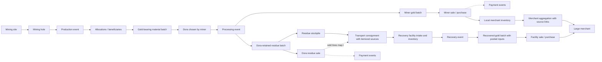

# Gold value chain and material genealogy

## Status labels

- **Confirmed project requirements:** both routes below must be represented and join at larger merchants; source references survive pooling; no unsupported per-miner recovery attribution.
- **Field observations:** the operating patterns described in the charter; validate them per pilot location.
- **Proposed model:** represent every physical transformation, allocation, trade and custody change as its own event. Keep quantity observations in the shared measurement ledger; material batches do not carry a competing quantity field.
- **Assumption requiring pilot validation:** participants can identify and agree the physical unit, weighing point, process boundaries and sample/assay conventions for each relevant material.

## Route A — miner gold sold through local merchant 

1. A site and mining hole are registered with separately linked landowner, permit-holder and operator relationships as applicable.
2. A production event records the originating hole and responsible party. One event can create several output batches.
3. A production event may produce multiple output batches. Each output has one allocation chain of complete revisions; each set has one basis, either quantity or share, and each row names a beneficiary. A set cannot mix bases. Pending, provisional, disputed, rejected, approved and withdrawn review states remain visible; provisional is non-final. Amendments are new revisions and only one revision per output can be current approved. An approved allocation expresses a reviewed distribution basis; it does not itself create legal entitlement, transfer custody or prove payment.
4. A miner selects a Dora. A processing event consumes one or more incoming batches and records all resulting outputs, such as miner-retained gold and residue retained by the Dora operator. Each input/output references a measurement set containing declared, measured and, where applicable, verified observations.
5. The miner's gold batch can be sold to a local merchant in a purchase event. The trade line links to the gold batch and records proposed transaction quantity, accepted trade quantity, separate seller-declared and buyer-measured observations, assay evidence, agreed price and currency. Payment and physical custody are separate linked records. A physical inventory deduction happens only when an accepted movement records material leaving a location.
6. A local merchant can aggregate purchased gold into a merchant inventory/aggregation batch. Each source purchase and source gold batch remains queryable. The merchant's sale to a larger merchant references the aggregation batch and its input purchases.
7. The larger merchant is the convergence participant for this route.

## Route B — Dora residue recovered and sold

1. Production and Dora processing follow steps 1–4 above.
2. Residue retained by the Dora operator is represented as a distinct output batch and a service-settlement/entitlement record. A fee or retained residue is not silently treated as cash payment.
3. The Dora operator may add residue batches from different customers to a stockpile. The stockpile is an inventory location in one authoritative movement journal. Each accepted addition posts an IN movement with a source batch and a measurement reference; there is no second stockpile balance ledger. The database serializes writers by batch/location and rejects a posting that would create negative available inventory.
4. The Dora-to-facility residue sale is a separate commercial record with proposed and accepted quantities; payment events reference that sale. Sale, shipment, receipt, custody and payment do not imply one another. Dispatch posts paired inventory legs in one atomic movement: OUT from the Dora stockpile and IN to a consignment transit location. The consignment manifest references source batch lines and their measurement sets but does not add another inventory posting.
5. At receipt, post accepted quantity OUT of the consignment transit location and IN to recovery facility inventory. If receipt differs from dispatch, transfer only the accepted quantity and leave the unresolved remainder in transit pending reconciliation or a reasoned adjustment. Custody acceptance remains a distinct event.
6. A recovery event consumes inputs from one or more received consignment/inventory lots and creates one or more outputs, including a recovered-gold batch. The event records lineage and inventory OUT/IN postings. Input/output quantities may differ due to processing, sampling or variance; the reason is recorded. Residue and process waste are material types within the gold chain, not additional minerals.
7. Each recovered-gold batch references every contributing input consignment/item and source residue lineage. It can be sold directly by the recovery facility owner to a larger merchant through the same purchase/sale, assay, payment and custody records used for Route A.
8. The larger merchant is the convergence participant for this route.

## Material genealogy rules 

- A material batch is a traceable inventory lot with a material category, current workflow state and provenance. Quantity observations live in `material_measurement`, not on the batch row. A batch identifier is not proof of assay, purity, ownership or custody.
- One event can consume multiple input batches and create multiple output batches. Use explicit event-input and event-output rows. The resulting graph is many-to-many across transformations.
- Quantity observations are stored in a single measurement ledger, not duplicated as batch-level declared/current quantity. Each measurement set has exactly one typed relational owner and its owner's batch is enforced by composite foreign keys; the design does not rely on a `context_kind/context_id` polymorphic pointer. Proposed storage normalizes mass to grams at `NUMERIC(20,6)` and preserves the entered unit/value and conversion version; that is storage precision, not instrument accuracy.
- Material transformations, splits and joins link event input/output records to measurement sets. A process may have documented loss, moisture change, sampling, or unmeasured variance; the model records a variance/reason rather than assuming exact mass balance.
- A split creates output batches with source edges to the input. A pool/merge creates one output batch with edges to all contributing input batches. Do not delete or relabel source lots to make a merged lot appear to have a single origin.
- Inventory balance is derived per location and batch from accepted IN minus OUT postings. A same-batch transfer has balanced source and destination legs in one transaction; deferred database validation rejects one-sided or unbalanced transfer postings. Balance-key guard locks serialize concurrent OUT commands. A failed transaction leaves no partial movement. A consignment manifest is not a second posting. Physical count differences become reasoned adjustment movements and are not automatically evidence of theft or fraud.
- Accepted movement correction uses a new linked reversal/adjustment journal entry. A transformation links its inventory OUT lines to consumed inputs and IN lines to created outputs; quantities may differ with a recorded reason. Location/custodian handover uses balanced location-account postings and remains separate from ownership or contractual entitlement.
- Residue stockpiles retain batch-level source references through inventory movement lines. A consignment can consolidate lots physically while retaining item-level measurement sets and source links.
- A recovery event can draw from multiple consignments. The recovered batch links to each contributing input, but the individual miner's recovered weight is unknown unless the parties approve a defensible allocation method and capture its basis, version, inputs, and calculations. Without that, report the pooled output and its contributing sources only.
- Merchant aggregation is a genealogy operation: the merchant's batch lists source purchase lines/batches, while original purchase records, counterparties and assay/payment/custody facts remain intact.
- Gold and residue transaction quantities are contractual values, not weighings. Seller declarations and buyer measurements remain separate append-only observations; accepted trade quantity is the counterparties' settlement basis. Physical deductions are movement postings and can occur in partial shipments.
- Each gold trade or residue sale chooses one currency; payment rows and events must use that same currency. No currency conversion or Kenyan-shilling default is assumed in the initial MVP; supported currencies and money precision require an owner/pilot decision.
- Never infer ownership or custody from a genealogy edge. Entitlement and custody have separate records.

## Flow diagram

## Questions for pilot mapping

Confirm how a production batch is measured and allocated; whether processing is recorded per miner, machine run or shift; how service residue is agreed; whether a stockpile has physical compartments; what establishes seal, shipment and receipt; how recovery input/output is sampled; when recovered material becomes a saleable lot; and what source-link detail merchants will share with counterparties. These are open questions, not universal practices.
