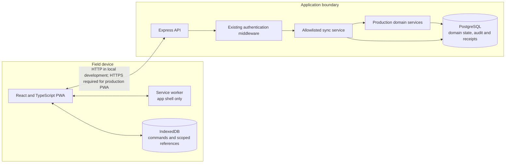
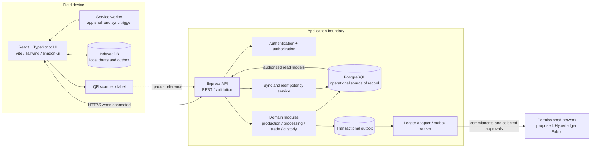

# System architecture and API proposal

## Phase 5 implemented architecture (verified 2026-11-19)

The implemented technical slice is a React 19/TypeScript/Vite PWA, the existing Node.js/Express modular monolith, and PostgreSQL. The browser stores immutable versioned commands and scoped references in IndexedDB. Its service worker caches only the application shell; synchronization runs on online/foreground opportunities. The Express authentication middleware protects both sync routes, the sync service rechecks current access, and accepted commands run through the existing production domain services. Migration 009 stores durable receipts and append-only receipt history. There is no ledger adapter, outbox worker, or production hosting configuration.

The client does not cache API responses or hold long-lived credentials. Current sync commands are production creation, production measurement addition, and separate capture acknowledgement. This software has passed its local automated checks but has not been deployed or field-accepted.

## Proposed architecture

Use a modular monolith for the prototype: one React PWA, one Node.js/Express API, one PostgreSQL database, and an asynchronous ledger adapter. Modules have explicit boundaries and business rules stay in backend domain services. This meets the requested separation of concerns without introducing microservices or an additional orchestration framework before scale or independent deployment needs are known.

The diagram is conceptual. It does not assert that a permissioned network exists or that ledger submission is already implemented.

## Components and responsibilities

- **React/TypeScript PWA:** forms, accessible error/state presentation, participant views, offline queue visibility and QR scanning. The client may validate for usability, but it is not authoritative for business rules or permission checks.
- **Service worker:** app shell caching and background/foreground sync opportunities. Browser support, storage limits, device-sharing and reliable background execution require pilot validation.
- **IndexedDB:** locally scoped drafts and immutable command envelopes awaiting server acknowledgement. It is not a shared database and cannot attest that an event was accepted.
- **Express API:** versioned HTTP boundary, authentication middleware, request validation, rate/size limits, API error model and module routing.
- **Domain services:** enforce workflow, role scope, quantity/inventory constraints, counterpart acceptance, event correction and audit requirements.
- **PostgreSQL:** authoritative operational state, immutable measurement observations, one inventory movement journal, event history, idempotency receipts, audit streams and transactional outbox. Stockpile and consignment balances are projections of this journal.
- **Ledger adapter:** accepts only allowlisted commitments and receipts; retries independently. Business operations must remain valid when the ledger is unavailable unless a pilot rule explicitly gates them.
- **Sequelize ORM:** selected for this implementation at the project owner's direction. Keep domain services independent of ORM-specific types; use reviewed SQL migrations and explicit SQL where needed for PostgreSQL locking, constraints or query performance.

## API conventions

- Prefix: `/api/v1`; JSON over HTTPS; UUID identifiers; UTC timestamps; explicit `schemaVersion` for offline command envelopes.
- Use resource reads for queries and command endpoints for state changes. Every write accepts an `Idempotency-Key` (same value as the client mutation ID) and returns a stable command/event ID plus processing state.
- Use cursor pagination for event histories and inventory lists. Scope every query by authenticated role and participant relationship. Return only fields the caller is allowed to see.
- Concurrency-sensitive changes include an expected record version or `If-Match` value. Conflicts return a machine-readable conflict result without overwriting accepted history.
- Errors distinguish invalid input, forbidden scope, missing prerequisite, stale version, duplicate with changed payload, and temporary retryable server/network failure.

## API modules and representative endpoints

| Module | Representative endpoints | Main responsibility |
|---|---|---|
| Identity and access | `GET /me`, `GET /me/roles`, admin `POST /role-assignments` | User identity, scoped role grants, revocation and audit. |
| Sites and participants | `GET/POST /sites`, `/sites/{id}/holes`, `/sites/{id}/relationships`, `/facilities` | Register sites, holes, parties, relationship evidence and facility operators. |
| Production | `POST /production-events`, `GET /production-events/{id}`, `POST /production-outputs/{id}/allocation-sets`, `POST /allocation-sets/{id}/reviews`, `POST /allocation-sets/{id}/corrections` | Create complete output-specific revisions; every set is quantity-based or share-based; review and current-approved pointer update are serialized on the allocation chain. |
| Processing and residue | `POST /processing-events`, `POST /inventory/movements`, `GET /inventory/locations/{id}/balance` | Record selected Dora, inputs, multiple outputs and residue retention; validate transformation input/output links and use one journal for all stockpile and facility postings. |
| Consignments and transport | `POST /consignments`, `/consignments/{id}/dispatch`, `/receive`, `POST /residue-sales` | Dispatch/receipt movements atomically transfer stockpile → transit → facility; manifests reference batches without posting inventory twice; residue sale is separate. |
| Recovery and inventory | `POST /recovery-events`, `GET /facilities/{id}/inventory`, `GET /inventory/locations/{id}/balance` | Link pooled inputs to recovered-gold batches; all balances derive from the shared movement journal. |
| Gold trade and assay | `POST /gold-trades`, `/gold-trades/{id}/lines`, `/assays`, context-scoped measurement-set commands | Proposed and accepted trade quantities, separate seller/buyer observations, assay references and agreed terms; database measurement-set owner is one typed context, not a polymorphic pointer. |
| Payments | `POST /gold-trades/{id}/payments`, `POST /residue-sales/{id}/payments`, `POST /payments/{id}/events`, `GET /payments/{id}/reconciliation` | Shared payment service for both transaction types; append report/confirmation/failure/reversal/correction events and derive net settlement. |
| Custody and entitlement | `POST /custody-transfers`, `POST /custody-transfers/{id}/accept`, `POST /entitlement-events` | Offer/accept custody; record entitlement claims independently. |
| Assisted capture | `POST /events/{id}/capture-provenance`, `/capture-acknowledgements` | Record participant, recorder, information source, acknowledgement and evidence without implying consent. |
| Traceability and QR | `GET /batches/{id}/genealogy`, `POST /qr-records`, `GET /q/{opaqueToken}` | Authorized provenance view and opaque QR lookup. |
| Offline synchronization | `POST /api/v1/sync/commands`, `GET /api/v1/sync/receipts/{clientMutationId}` | Implemented idempotent upload and durable-receipt recovery for production creation, production measurement addition and separate capture acknowledgement. |
| Audit and ledger | `GET /audit/{aggregate}`, `GET /ledger-submissions/{eventId}` | Scoped history, commitment and network receipt status. |

Other representative endpoint names are proposals, not a final OpenAPI contract. Do not create a generic endpoint that permits clients to write arbitrary event rows or bypass domain services. The measurement API resolves one explicit owner type to a typed relational FK and verifies its batch; clients cannot reassign an existing measurement set.

Payment creation under either a gold trade or residue sale creates an append-only reported-payment event. `/payments/{id}/events` appends counterparty confirmation, failure, reversal or correction with actor, timestamp, reason and evidence reference; it never edits the reported amount/status. The reconciliation endpoint derives net confirmed settlement per currency from event history. A payment report is not a confirmation, and reconciliation does not imply custody transfer.

## Backend command lifecycle

1. The existing middleware authenticates the user, and the sync service rechecks live account status, current role assignment, acting party and resource access.
2. Validate the versioned command against the explicit allowlist, dependencies, expected audit sequence and immutable envelope hash. An identical mutation ID and payload returns its durable receipt; changed content under that ID is rejected.
3. Persist `server_received`, then dispatch ready work through the existing production domain service. Domain state, audit append and accepted receipt transition commit atomically. Deterministic domain conflicts/rejections are retained as receipt outcomes.
4. Return the durable receipt and persist it in IndexedDB before the client updates the local state. After an unknown network outcome, the client queries the receipt route and retries with the original mutation ID when needed.
5. Ledger commitment, an outbox worker and network receipts are future work; they are not implied by server acceptance.

For inventory movements, the server locks per-batch/location guard rows in stable order, derives balances from accepted journal lines, rejects any negative post-command balance, and writes the complete movement, accepted state and audit entries in one database transaction. Deferred database constraints validate balanced transfer legs; transformation inputs/outputs link to event genealogy and may carry a reasoned mass variance. Failure rolls back every leg. Accepted corrections append reversal/adjustment postings. Audit event ordering is per aggregate stream, with affected stream heads locked in stable sorted order, as detailed in [Blockchain design](BLOCKCHAIN_DESIGN.md). Payments and allocation reviews use the same append-only command/audit path.

Allocation-set approval locks its output chain, verifies the set's single basis and totals, appends review history and moves at most one current-approved pointer atomically. Payment creation and events carry the parent transaction currency; composite database foreign keys reject a different payment/event currency. These checks run server/database-side before any asynchronous ledger handoff.

## Operational concerns for later phases

Define API versioning and compatibility for queued offline commands before pilot deployment. Add structured logs with opaque IDs, metrics for sync backlog and ledger delay, audit-log protection, backups/restore drills and evidence retention only after requirements and operating ownership are agreed. Do not log sensitive request payloads or credentials.
